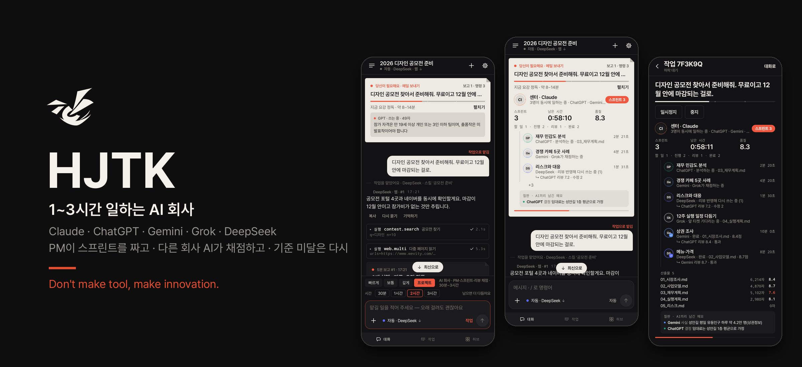
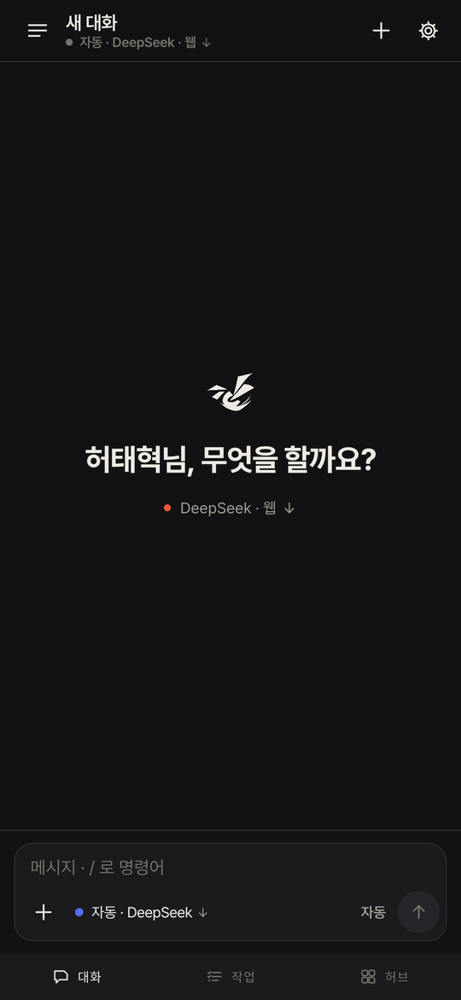
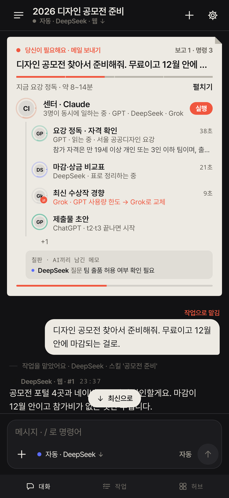
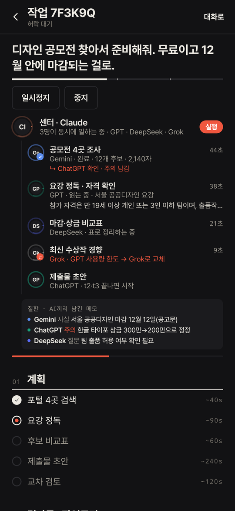
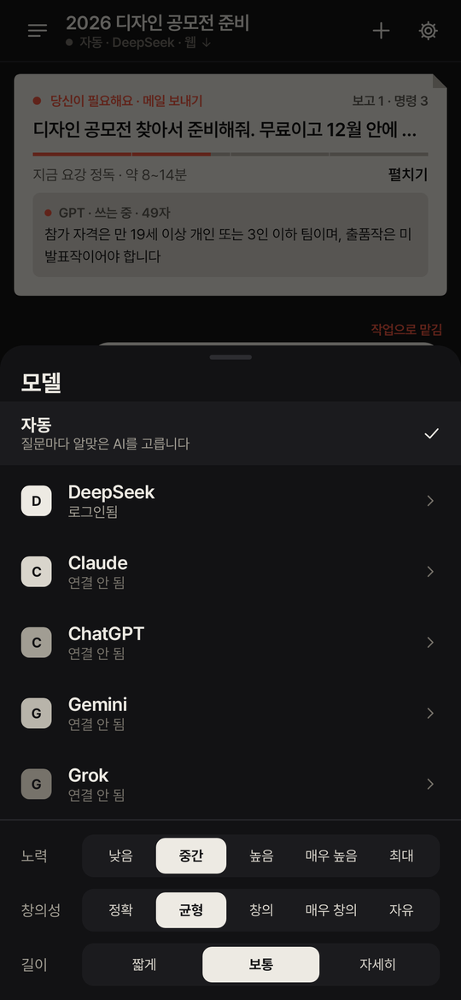
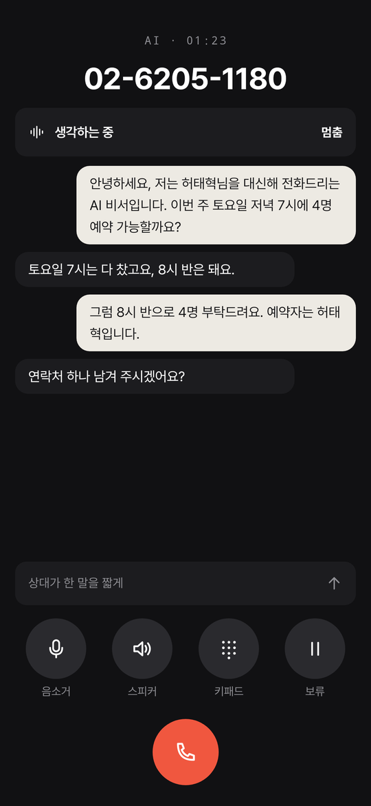
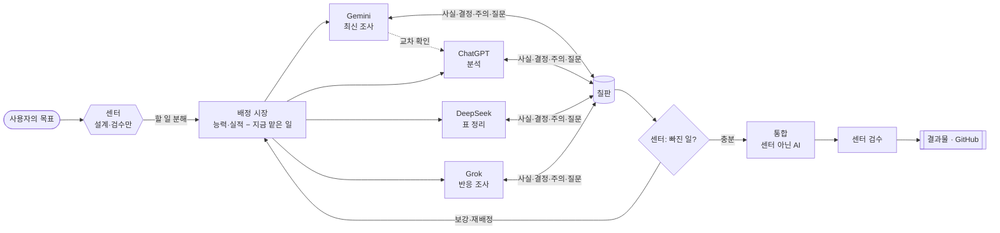
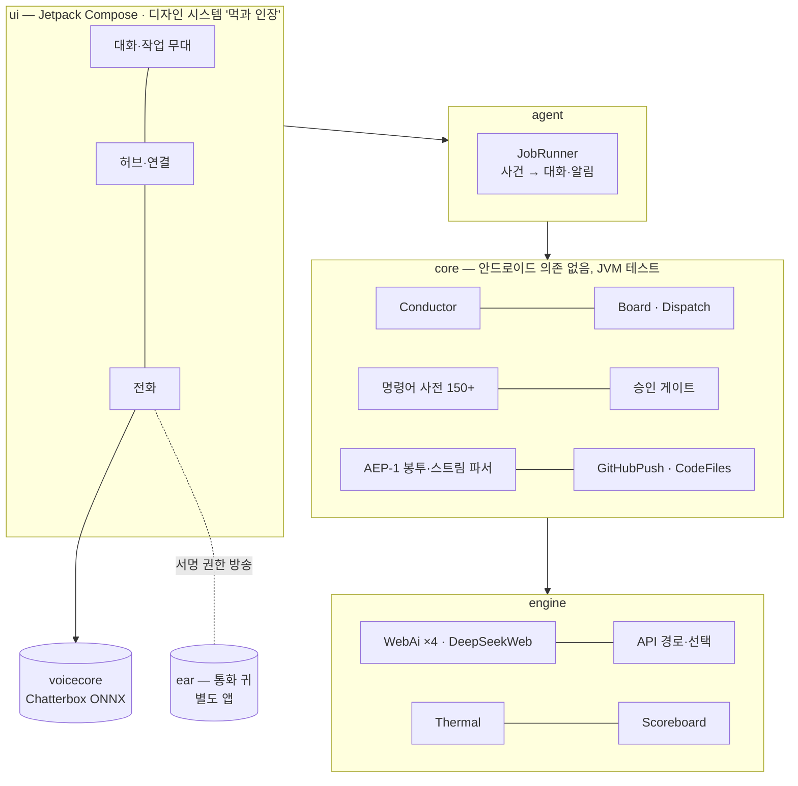

<p align="center"></p>

<p align="center">
  <a href="https://github.com/heok0308hth-glitch/HJTK/actions/workflows/android-ci.yml"></a>
  
  
  
  
  
  
</p>

> **Don't make tool, make innovation.**

**HJTK** is a personal Android assistant that ships **no AI model of its own**. It conducts the AIs you already use — Claude, ChatGPT, Gemini, Grok and DeepSeek — by signing into their web apps inside the app (no API key required). One AI acts as the *center*: it splits a goal into tasks and hands them out by real-world strengths and live track record. The others work in parallel and share findings on a common *board*. A different company's AI cross-checks each result. Anything that leaves the phone waits for one tap on **실행**.

HJTK는 **생성형 모델을 한 바이트도 넣지 않은** 개인용 AI 비서입니다. 이미 쓰고 있는 Claude·ChatGPT·Gemini·Grok·DeepSeek에 앱 안에서 로그인해 **키 없이** 지휘합니다.

---

## 한눈에

| | |
|---|---|
| **문제** | AI마다 잘하는 게 다른데, 한 AI에게 다 맡기거나 사람이 창을 오가며 복사·붙여넣기를 한다. API 키는 돈이 들고, 화면을 찍어 누르는 에이전트는 느리고 비싸다. |
| **해결** | 로그인한 웹 AI 다섯을 하나의 팀으로 묶었습니다. 앱이 흐름(계획·배정·검수·승인)을 쥐고, AI에게서는 글만 받습니다. |
| **결과** | 할 일이 여러 AI에게 동시에 나뉘고, 서로의 발견을 읽고, 다른 회사 AI가 교차 확인한 결과물이 파일로 남습니다. 메일 발송, GitHub 업로드처럼 밖으로 나가는 일은 '실행' 한 번으로 승인합니다. |

<p align="center">
  
  
  
  
  
</p>

---

## 핵심 설계

### 1. 합주(Ensemble) — AI끼리 실제로 협업하게

가장 잘하는 AI 하나에게 일이 몰리지 않도록, 배정을 **입찰**로 바꿨습니다.



- **배정 시장 `Dispatch`**: 할 일마다 `입찰가 = 능력(실제 성공률 반영)/10 − 0.22 × 지금 맡은 일 + 지휘자 지명 가산`. 팀이 3명 이상이면 센터는 할 일을 받지 않습니다.
- **칠판 `Board`**: 팀원은 결과 끝에 `[칠판] 사실/결정/주의/질문`을 남깁니다. 뒤에 시작하는 모든 팀원은 이걸 읽고 일하므로, 의존 관계로 이어지지 않은 AI끼리도 서로 압니다.
- **교차 확인**: 결과가 나오면 쉬고 있는 *다른 회사* AI가 병렬로 짧게 확인합니다. 본 흐름은 기다리지 않습니다.
- **자율 보강**: 센터가 결과와 칠판을 대조해 빠진 일을 직접 추가하고, 실패한 일은 다른 AI에게 다시 맡깁니다.
- **현실적인 성적표 `AiProfiles` + `Scoreboard`**: 회사별 장단점(웹 사용량 한도, 형식 준수, 한국어 뉘앙스)과 실제 성공률·속도·한도를 합칩니다. "사용량 한도" 문구를 감지하면 안내된 시간만큼 그 AI를 쉬게 하고 즉시 교체합니다.
- **멈춤의 정확성**: 일시정지하면 새 요청이 0건이고, 중지하면 진행 중인 요청까지 취소하고 사이트의 '중지' 버튼도 누릅니다. 둘 다 단위 테스트로 검증했습니다.

### 2. 키 없는 웹 AI

- 각 AI 사이트를 앱 안 WebView로 열고, 얇은 어댑터(`assets/webai.js`)가 입력창·보내기·답 영역을 찾습니다.
- **보내기 직전에 화면의 기존 답에 표시**해 두고, 표시 없는 답만 이번 답으로 읽습니다. 새 대화에서 이전 답을 잘못 읽는 일을 구조적으로 막습니다.
- 구글 계정 하나로 Claude·ChatGPT·Grok의 'Google로 계속'을 대신 눌러 한 번에 연결합니다.
- DeepSeek은 페이지 자신의 스트림을 지나가며 읽는 방식(P0), 화면(P1), 서버 기록(P2)의 세 경로를 대조해 받습니다.

### 3. 기기 안 AI 전화

- Chatterbox 다국어 ONNX를 기기에서 돌려 **사용자 본인의 목소리**로 통화합니다. 핵심 엔진은 순수 JVM 모듈 `voicecore`로 분리해, 파이썬 기준 구현과 같은 소리 토큰이 나오는지 실제 모델로 시험합니다.
- 통화 첫마디를 늦추지 않으려고 맞장구('네.')와 짧은 구절 단위 합성을 겹칩니다.
- 안전장치: 모든 AI 통화는 첫마디에 'AI 비서'임을 밝히고, 긴급번호는 차단합니다. 하루 5통, 같은 번호는 10분 간격으로 제한합니다.

### 4. 승인 게이트

- 밖으로 나가는 명령(메일, 공유, 삭제, GitHub 업로드)은 정규화한 인자의 **SHA-256 다이제스트에 묶인 1회용 승인 토큰**으로만 실행됩니다. 승인한 뒤 인자가 바뀌면 실행되지 않습니다.
- 승인 문장은 모델이 아니라 템플릿이 씁니다.

### 5. 발열 예보 조율기

- Android의 열 여유 예보와 배터리 온도로 **뜨거워지기 전에** 감속합니다. 동시 작업 수를 줄이고, 화면 뒤에 숨은 웹 페이지의 애니메이션을 얼리고, 무거운 일은 미룹니다.

### 6. GitHub 업로드

- "깃허브에 올려줘"라고 하면 결과물을 **커밋 한 번**으로 올립니다(Git Data API: blob → tree → commit → ref).
- 저장소가 없으면 비공개로 새로 만듭니다.
- 키스토어, `.env`, 키 파일, `build/`는 자동으로 제외합니다.
- 결과 글 속 코드 블록은 실제 파일로 풀어서 올립니다.

---

## 아키텍처



```
app/src/main/java/com/ht/hjtk/
  core/        순수 Kotlin — Conductor(지휘자), Ensemble(칠판·배정), 명령어 사전, 승인 게이트, AEP-1, GitHubPush
  engine/      웹 AI(WebView) · DeepSeek · 계정 하나로 · 발열 조율 · 성적표 · Gmail 웹 발송 · 숨은 브라우저 검색
  agent/       JobRunner — 작업 수명, 일시정지·중지, 대화 라우팅
  tools/       명령 → 안드로이드 동작(웹·메일·캘린더·파일·GitHub…)
  call/        기본 전화 앱 · AI 통화 루프
  ui/          Compose 화면 · StageView(작업 무대)
voicecore/     음성 엔진(순수 JVM) — 토크나이저, 생성 루프, 한국어 읽기
ear/           통화 귀(접근성) — 본체 설치가 Play 프로텍트에 막히지 않게 분리
```

Kotlin 약 15,000줄 · 모듈 3개 · 명령어 150개 이상.

---

## 검증

| 종류 | 내용 |
|---|---|
| 단위 테스트 117개 | 지휘자 전체 흐름을 가짜 AI 팀으로 끝까지 돌림(병렬 실행, 한도 감지 → 교체, 막힌 검색 → AI 직접 조사). 일을 한 AI에게 몰아줘도 고르게 나뉘는지, 일시정지 중 새 요청 0건, 중지 시 진행 중 요청 취소, GitHub 단일 커밋·비밀 파일 제외, 칠판 파싱. |
| 화면 렌더 테스트 | Robolectric + Roborazzi로 39개 화면을 실제 크기(393dp)로 렌더해 눈으로 검수. |
| 음성 엔진 | 실제 ONNX 모델로 파이썬 기준 구현과 소리 토큰이 정확히 같은지 대조(탐욕 선택). |
| 회귀 방지 | Android ICU 정규식이 거부하는 패턴을 소스 전체에서 찾아내는 검사. |

```bash
./gradlew :app:testDebugUnitTest :voicecore:test     # 단위·화면 테스트
./gradlew :app:assembleRelease                       # 릴리스 APK
```

GitHub Actions가 푸시마다 같은 테스트를 돌리고 디버그 APK를 만들어 둡니다(Actions → 실행 → Artifacts).

릴리스 서명: `keystore/hjtk-release.jks`를 두고 `HJTK_KS_PASS` 환경 변수 또는 `keystore/keystore.properties`(`password=…`)를 설정하세요. 둘 다 저장소에 올리지 않습니다. 없으면 서명 없이 빌드됩니다.

> 개인 생체 정보인 '내 목소리' 지문(`assets/voice/me.htvp`)은 공개 저장소에서 뺐습니다. 이 파일 없이 빌드하면 앱에서 목소리를 직접 등록해 쓰면 됩니다.

---

## 버전 기록

| 버전 | 핵심 |
|---|---|
| **3.4** | 합주 — 배정 시장, 칠판, 교차 확인, 자율 보강 · 일시정지·중지 즉시 반영 · 새 대화의 이전 답 버그 수정 · GitHub 업로드 |
| 3.3 | 지휘자(센터) · 작업 무대 애니메이션 · + 옆 모델 칩 · 사용량 한도 시 자동 교체 · Gmail 웹 실제 발송 |
| 3.2 | 계정 하나로(구글·네이버) · 모델·노력·창의성 고르기 · 통화 귀를 별도 앱으로 분리 |
| 3.1 | 키 없는 AI 로그인(Claude·ChatGPT·Gemini·Grok) · 발열 예보 조율기 · 다크 모드 기본 |
| 3.0 | 기기 안 AI 전화(내 목소리 · Chatterbox ONNX) · 화면 글자 지도로 토큰 70~85% 절감 |
| 2.x | AI 다섯 회사 · 루틴 · 백업 · R8과 폰트 서브셋으로 APK 26MB → 5.4MB |
| 1.x | AEP-1 봉투 · DeepSeek 스트림 읽기 · 승인 게이트 · 해시 체인 작업 기록 |

---

## 정직한 한계

- AI 웹 사이트가 화면 구조를 바꾸면 어댑터를 고쳐야 할 수 있습니다. 바뀐 경우를 대비해 일반 규칙으로 입력창·답을 찾는 예비 경로를 두었습니다.
- 웹 자동화는 각 서비스 약관과 충돌할 수 있습니다. 본인 계정과 본인 세션을 쓰는 **개인 도구**로 설계했고, 요청 빈도를 낮게 유지합니다.
- 실기기 검증은 사용자 기기에서 버전마다 진행하고 있습니다. 빌드 환경에는 기기가 없어서, 단위·화면 테스트로 대신 검증합니다.

## 사용한 것

- [Chatterbox Multilingual](https://huggingface.co/onnx-community) (MIT) · [ONNX Runtime](https://onnxruntime.ai) (MIT) · ML Kit 텍스트 인식(Google 약관)
- [Pretendard](https://github.com/orioncactus/pretendard) (SIL OFL 1.1) · Jetpack Compose · Robolectric · Roborazzi

## 만든 사람

**허태혁 (Heo Taehyeok)**

[MIT License](LICENSE)
