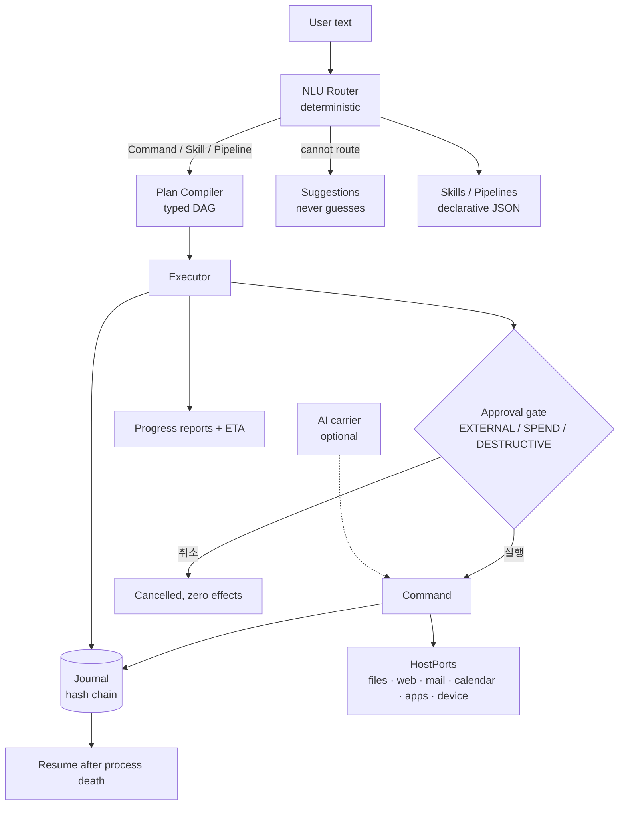

# HJTK

**A deterministic AI orchestration toolkit for Android.**
No on-device model, no mandatory API key, no screenshot-and-tap loop.

HJTK turns what you type into a **typed, auditable plan**, shows exactly what will
leave the phone, runs it, and keeps a crash-proof journal so nothing is silently
lost. AI models are an *optional* dependency, reached through one small carrier
interface — the app itself is a rules engine.

```
사용자: "안드로이드 15 검색해서 요약해줘"
HJTK  : search.web → ai.summarize
         → 계획 카드: 2단계 · 예상 9초
         → [실행] [취소]
```

---

## Why this exists

Most Android "agents" work like this: take a screenshot, send it to a vision
model, ask for tap coordinates, tap, repeat. That loop is expensive (a model
call per step), slow (seconds per tap), brittle (one mis-parsed screen and the
run is lost), and impossible to audit afterwards.

HJTK takes the opposite approach:

| | Screenshot + VLM agents | **HJTK** |
|---|---|---|
| Where the model runs | cloud vision model per step | **none on device**; the model is only an optional text endpoint |
| Cost per task | one inference per tap | **0 for the 64 built-in commands**, 1 call for a written answer |
| Latency per step | 1–4 s (screenshot → model → tap) | **200–900 ms** for local commands |
| Failure mode | wrong tap, no recovery | **typed DAG + journal + resume** from the last good step |
| Auditability | none | **hash-chained journal** of every transition |
| Side effects | happen implicitly | **blocked behind an approval card** unless the user taps 실행 |
| Determinism | sampling | **same text + same catalog = same plan** (router is unit-tested) |
| Multi-step | N round trips | **one AEP-1 envelope can carry a whole plan** |
| Keys | API key is mandatory | **works with no key**; keys are optional accelerators |

The result is an app you can leave running: it either does a small thing
instantly, or tells you honestly why it could not.

---

## Architecture



### Layers and their responsibilities

| Layer | Lives in | Contract |
|---|---|---|
| Router | `core/nlu` | text → route; deterministic; every case covered by a test |
| Compiler | `core/plan/PlanCompiler` | declarations → validated DAG (`{{out:N}}`, `{{var:name}}`, cycle checks) |
| Executor | `core/plan/Executor` | the only place a side effect can start; approval, journal, checkpoint |
| Journal | `core/plan/Journal` | append-only, SHA-256 chained, detects truncation and edits |
| Stores | `core/memory`, `core/skill`, `core/session`, `core/hub` | JSON persistence, no AI, no embeddings |
| Ports | `core/HostPorts` | every outside capability behind one interface |
| Android ports | `android/ports` | real implementations (OkHttp, IMAP/SMTP, CalendarContract, Intents…) |
| Carriers | `android/carrier` | model access as an optional, replaceable plug |
| UI | `ui/` | Compose; chat, hub, work, settings, command palette |
| Orchestrator | `core/orchestrator` | conversation + concurrent jobs (max 3) + per-job approval/cancel |

### Concurrency without lies

Up to three independent plans run at once. A step that would collide with
another job — the same model session, the same mail account, the system UI
(only one chooser can be on screen) — takes a `ResourceGuard` lock for that
step only. Local commands, web fetches and reads run in parallel.

```
job A: calendar.today ──► ok ──► ok
job B: search.web ──► ai.summarize (waits for carrier lock) ──► file.export
job C: device.battery ──► ok
```

Every job has its own id, progress, ETA, approval prompt, cancel handle and
checkpoint file. Stopping one never touches another.

---

## The command catalog (64 commands)

Adding a capability is one declaration plus one lambda — no changes to the
router, planner, UI or approval logic.

```kotlin
reg.register(
    CommandSpec(
        id = "calendar.today",
        labelKo = "오늘 일정",
        category = CommandCategory.CALENDAR,
        effect = EffectClass.READ,
        description = "오늘의 캘린더 일정을 읽습니다.",
        keywords = listOf("일정", "오늘", "스케줄")
    )
) { _, ports ->
    CommandResult.Ok(ports.calendar.today().joinToString("\n") { it.title })
}
```

| Category | Commands |
|---|---|
| 검색 (5) | `search.web` `search.news` `search.wiki` `search.images` `search.open_url` |
| 파일 (5) | `file.export_text` `file.export_session` `file.list_exports` `file.open_folder` `file.share_export` |
| 메일 (5) | `mail.status` `mail.unread` `mail.latest` `mail.compose` `mail.send` |
| 일정 (3) | `calendar.today` `calendar.new_event` `calendar.open` |
| 앱 (9) | `app.open` `app.list` `app.share` `app.custom_tab` `app.dial` `app.sms` `app.map` `app.store_search` `app.save_to_hub` |
| 파이프라인 (4) | `pipeline.list` `pipeline.run` `pipeline.status` `pipeline.stop` |
| 스킬 (3) | `skill.list` `skill.run` `skill.create` |
| 메모리 (4) | `memory.remember` `memory.recall` `memory.list` `memory.forget` |
| 클립보드 (2) | `clip.copy` `clip.read` |
| 알림 (3) | `notify.show` `notify.timer` `notify.alarm` |
| 디바이스 (6) | `device.battery` `device.storage` `device.network` `device.volume` `device.brightness` `device.torch` |
| AI (9) | `ai.ask` `ai.deepseek` `ai.gemini` `ai.summarize` `ai.translate` `ai.rewrite` `ai.compare` `ai.status` `ai.page_summary` |
| 허브 (3) | `hub.list` `hub.open` `hub.add` |
| 시스템 (6) | `system.settings` `system.diagnostics` `system.export_diagnostics` `system.help` `system.about` `system.speak` |

Commands declare an **effect class**; anything at `EXTERNAL` or above stops for
the approval card first:

| Effect | Meaning | Approval |
|---|---|---|
| `READ` | reads local state or the network | no |
| `LOCAL_WRITE` | writes only inside HJTK | no |
| `EXTERNAL` | leaves the app under your name (mail, share, dial, calendar) | **yes** |
| `SPEND` | costs money or a metered quota | **yes** |
| `DESTRUCTIVE` | cannot be undone | **yes** |

---

## AEP-1 and RRE — the two protocols that make it reliable

**AEP-1 (Agent Envelope Protocol)** is the text contract with a model. One
envelope carries a whole plan, so a single model turn can replace N screen
round trips:

```
@aep:1 plan
{"schema":"plan.v1","title":"아침 루틴","steps":[
  {"commandId":"calendar.today"},
  {"commandId":"mail.latest","args":{"limit":"5"}}]}
```

The parser walks a fixed seven-rung recovery ladder (strict fence → fenced
schema → header → balanced object → repair → plain prose). It never executes
anything it could not validate, and a plan that arrives without steps is
returned for one repair turn instead of being guessed at.

**RRE (Response Reconciliation Engine)** solves the bug that every bridge app
hits: streamed deltas and DOM snapshots describe the same answer differently.
RRE treats each arrival as a candidate, scores completeness, merges cumulative
frames without duplicating text, and **reports a confidence** — a snapshot-only
answer is marked less trustworthy than one confirmed by the stream.

---

## Reliability model

* **Journal** — one line per transition, each line hashing the previous one.
  `verify()` detects edits, truncation and out-of-order records.
* **Resume** — `plan_started` without `plan_finished` is found on startup; step
  results are checkpointed in private storage so a resumed plan does not resend
  a mail or relaunch an app.
* **ETA** — per-command EWMA with a sample count; promises get more accurate the
  more you use the app.
* **Honest failure** — every command returns `Ok`, `NeedInput` or `Failed`.
  "메일 계정이 연결되지 않았습니다" is a result, not a stack trace.

---

## Build and test

Requires JDK 17 and Android SDK 35 (CI does this for you).

```bash
./gradlew testDebugUnitTest    # 100+ unit + Robolectric tests
./gradlew assembleDebug        # app/build/outputs/apk/debug/app-debug.apk
./gradlew lintDebug
```

The test suite covers, among others:

| Area | What is asserted |
|---|---|
| Router | 20+ real Korean sentences map to the expected command; determinism over 20 repeats |
| Catalog | 64 commands, unique namespaced ids, every category populated, required slots carry examples, outward effects marked |
| Command smoke | **every command is executed** against fakes; `NeedInput` and exceptions fail the build |
| Compiler | cycles, forward references, variable substitution, missing slots |
| Executor | approval reject = zero effects, failing step stops the plan, resume skips finished steps |
| Journal | 50-record chain verifies, a single edited line is detected, corrupt lines are skipped |
| RRE | incremental, cumulative, overlapping and conflicting streams |
| Concurrency | three plans overlap, a fourth queues, cancelling one leaves the others intact, same-resource steps serialise |
| Android runtime (Robolectric) | engine composition root builds, secrets round-trip, files are written inside app storage, notifications work |

---

## Privacy and security

* Secrets (API keys, mail app passwords) are encrypted with **AES-GCM under an
  Android Keystore key**; when the key is unavailable the app asks again instead
  of falling back to a weaker store.
* The journal stores **SHA-256 digests**, never message bodies or mail contents.
* No analytics, no telemetry, no third-party SDKs. The only network calls are
  the ones a command you ran makes.
* `allowBackup=false` and data-extraction rules exclude everything: a backup or
  a device transfer will not carry your secrets or conversations.
* The app requests no broad package listing (`QUERY_ALL_PACKAGES`), no contacts,
  no SMS body access.

## License

MIT — see [LICENSE](LICENSE).

Third-party components: AndroidX / Jetpack Compose / Material 3 (Apache-2.0),
OkHttp (Apache-2.0), kotlinx.serialization & coroutines (Apache-2.0), Jakarta
Mail for Android (EPL-2.0/GPL-2.0 with Classpath Exception). No third-party
artwork is bundled; the launcher icon is a vector drawn for this project.
