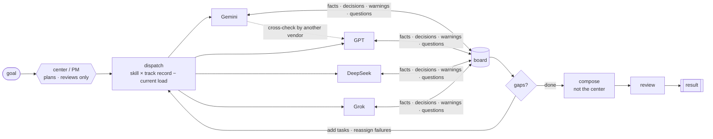

# HJTK Ensemble — a Kotlin multi-agent orchestration SDK

**Make Claude, GPT, Gemini, Grok, DeepSeek and local models work as one team — in plain Kotlin, on JVM, server or Android.**

[](https://github.com/heok0308hth-glitch/HJTK/actions/workflows/android-ci.yml)


Ensemble is the engine extracted from the [HJTK](../README.md) Android app. Most agent frameworks keep calling one model again and again. Ensemble treats several models like **colleagues with different strengths**:

- a **center** (or **PM**) plans the work and reviews it, but does not take the tasks itself
- a **load-aware dispatcher** spreads tasks by real strengths and live track record
- teammates share findings on a **board**, so agents that do not depend on each other still know what the others found
- results are **cross-checked by a different vendor's model**
- a **company mode** runs a project for 30 minutes to 3 hours: a charter with its own rubric, sprints of tickets, review scores with rejection and revision, stand-ups, a final QA and a report

The whole runtime is a small Kotlin library. It depends only on `kotlinx-coroutines` and `org.json`.

---

## Install

**JitPack**

```kotlin
// settings.gradle.kts
dependencyResolutionManagement { repositories { mavenCentral(); maven("https://jitpack.io") } }

// build.gradle.kts
dependencies {
    implementation("com.github.heok0308hth-glitch.HJTK:ensemble:<tag-or-commit>")
}
```

On **Android**, `org.json` is part of the platform, so exclude it:

```kotlin
implementation("com.github.heok0308hth-glitch.HJTK:ensemble:<tag>") { exclude(group = "org.json", module = "json") }
```

**From source**: copy the `ensemble/` module into your build and add `include(":ensemble")`.

## Quick start

```kotlin
import com.ht.ensemble.Ensemble
import com.ht.ensemble.ai.Provider
import com.ht.ensemble.ports.Ports

val team = Ensemble.team {
    member(Provider.CLAUDE,   Ports.anthropic(System.getenv("ANTHROPIC_API_KEY")))
    member(Provider.GPT,      Ports.openAi(System.getenv("OPENAI_API_KEY")))
    member(Provider.GEMINI,   Ports.gemini(System.getenv("GEMINI_API_KEY")))
    member(Provider.DEEPSEEK, Ports.deepSeek(System.getenv("DEEPSEEK_API_KEY")), lanes = 2)
    onEvent { println(it) }                       // live events: plan, assignment, board notes, swaps, reviews
}

// minutes: center plans → dispatch → parallel work + board + cross-check → compose → review
val r = team.conduct("Compare the 2026 design competitions and make a prep plan")
println(r.text)

// an hour: PM charter → sprints → review scores → stand-ups → final QA → report, with files on disk
val p = team.project("Business plan for a small café", minutes = 60, dir = File("out"))
```

Try it **without any API key**:

```bash
./gradlew :samples:cli:run --args="--demo"
./gradlew :samples:cli:run --args="--project 30 Business plan for a small café"   # uses whichever *_API_KEY env vars are set
```

## Ports — connect any model

| Port | Covers |
|---|---|
| `Ports.openAiCompatible(name, baseUrl, key, model)` | anything that speaks `/chat/completions` |
| `Ports.openAi` · `Ports.deepSeek` · `Ports.grok` · `Ports.gemini` · `Ports.openRouter` | presets of the one above |
| `Ports.ollama("qwen3")` | local models, no key |
| `Ports.anthropic(key, model)` | Anthropic Messages API |
| `Ports.fn(name) { prompt -> … }` | your own function: a gateway, a fine-tune, or a fake for tests |

Ports **never throw**. A failure comes back as an empty reply with a reason (`HTTP429`, `ERR:…`), and the engine moves the work to the next best teammate. Usage-limit messages and `429` responses also put that model on a short rest.

Implement `LlmPort` yourself for anything else. The HJTK app does this for logged-in web sessions, so it needs no API key.

## How it works



| Piece | What it does |
|---|---|
| `Conductor` | A job that takes minutes. Plans a DAG of tasks, runs the independent ones in parallel, cross-checks the results, adds missing work, then composes and reviews. |
| `Company` | A project that takes 30 minutes to 3 hours. Charter and rubric, sprints of tickets (one ticket = one file), review scores with rejection (below 8/10) and revision, stand-ups, final QA and report. Checkpoints after every ticket, so a project can be resumed. |
| `CrewDesk` | The shared calling desk. Tracks who is busy, credits finished work, limits concurrency per model (`lanes`), fails over (empty reply, refusal, usage limit, login error), and handles pause and abort. |
| `Dispatch` | Each task is bid on: `skill/10 + hint − 0.22 × load − center penalty`. The best model no longer gets everything. |
| `Board` | Teammates end their output with `[칠판] 사실/결정/주의/질문` (facts, decisions, warnings, questions). The notes are stripped from the output and shown to everyone who starts later. |
| `AiProfiles` | Realistic per-vendor strengths and weaknesses, used as the base skill for dispatch. |
| `ApprovalGate` | Anything external, such as e-mail or uploads, runs only with a one-time token bound to the SHA-256 digest of its normalized arguments. |
| `StageBus` | A live `StateFlow` of who is doing what, ready for any UI. |

**Pause and abort are exact.** On pause, no new request is sent. On abort, in-flight requests are cancelled immediately. Unit tests cover both.

## Tools and approvals

```kotlin
Ensemble.team {
    member(...)
    tools(myToolPort, catalog = """
        web.search(q) search the web
        mail.send(to, subject, body) send an e-mail [approval]
    """.trimIndent())
    approve { req -> askTheUser(req.summary) }   // default: reject everything external
}
```

`ToolPort.spec(id)` describes each command and its `Effect` (`READ`, `LOCAL`, `EXTERNAL`, `DESTRUCTIVE`). Anything at `EXTERNAL` or above asks your `approve` callback first.

## Testing your own agents

Every engine takes a `clock`, and every model is a port. A two-hour project can run in a few seconds with fake models and a fake clock, so tests are deterministic. See [`CompanyTest`](src/test/kotlin/com/ht/ensemble/CompanyTest.kt). Those tests caught three real concurrency bugs in this engine.

```bash
./gradlew :ensemble:test
```

## Status

`0.1.0`: the API may still change. Prompts are written in Korean, the language of the original app, and the models answer in kind. Swapping the prompt language is on the roadmap.

## License

MIT · made by a student, as part of HJTK.

---

### 한국어 요약

**HJTK Ensemble**은 HJTK 앱의 두뇌를 떼어 낸 Kotlin 멀티 에이전트 오케스트레이션 라이브러리입니다. 안드로이드 없이 서버·데스크톱·안드로이드 어디서나 쓸 수 있습니다.

- **팀으로 일합니다**: 센터(PM)는 설계·검수만 하고, 일은 각 AI의 실력과 지금 맡은 양을 따져 고르게 나눕니다.
- **서로 알고 서로 확인합니다**: 팀원은 칠판으로 발견을 공유하고, 결과물은 다른 회사 AI가 교차 확인합니다.
- **두 가지 모드**: 몇 분짜리 `conduct`와 30분~3시간짜리 `project`(헌장·스프린트·리뷰 채점·QA·보고서)가 있습니다.
- **어떤 AI든 연결**: OpenAI 호환 · Anthropic · Gemini · DeepSeek · Grok · Ollama · 내 함수(`Ports.fn`).
- **키 없이 체험**: `./gradlew :samples:cli:run --args="--demo"`
